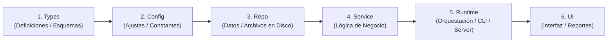
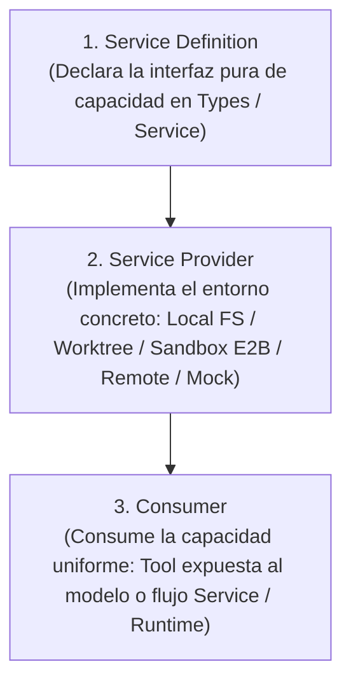

# ARCHITECTURE.md

Este documento es el mapa superior del sistema. Debe mantenerse conciso, definir qué dominios existen, qué capas pueden comunicarse entre sí y cómo se imponen mecánicamente las fronteras arquitectónicas, enrutando a documentos más profundos cuando sea necesario.

## 1. Forma General del Sistema

- **Proyecto / Flujo de Trabajo:** Aplicación gobernada por el Arnés de Ingeniería para Agentes Autónomos de Larga Duración.
- **Flujo Principal del Sistema:** Recibe especificaciones de tareas secuenciales (`feature_list.json`) y produce entregables de software verificados a través de **3 Puertas en orden estricto** (Estática -> Comportamiento -> Sistema Completo), preservando el repositorio en un estado limpio y reiniciable (`clean-state`).
- **Superficies de Ejecución:** Scripts POSIX (`init.sh`, `scripts/check-architecture.sh`), validadores y runners CLI en Node.js (`scripts/validate-harness.mjs`, `scripts/harness-hooks.mjs`) y módulos de aplicación del proyecto objetivo (`web`, `cli`, `desktop`, `services` o `workers`).
- **Fuente de Verdad del Comportamiento:** `feature_list.json`, `sprint-contract.md`, `ARCHITECTURE.md` y `docs/product-specs/` (cuando exista en el proyecto).

## 2. Mapa de Dominios

| Dominio (Área) | Propósito (De qué es dueño) | Carpeta / Punto de Entrada | Especificación Relacionada |
| :--- | :--- | :--- | :--- |
| **Aplicación / Producto (`app`)** | Módulos de negocio del proyecto organizados bajo las 6 capas estrictas (`src/types`, `src/config`, `src/repo`, `src/service`, `src/runtime`, `src/ui`) | `src/` (o carpetas equivalentes mapeadas en proyectos *Brownfield*) | `feature_list.json`, `sprint-contract.md`, `docs/product-specs/` (bajo demanda) |
| **Gobernanza e Instrucciones (`instructions`)** | Índice operativo del agente (~100 líneas), Startup Workflow, escalado, reglas `WIP = 1`, prompts `Maker-Checker`, Skill bajo demanda, grafo de 5 nodos y mapa arquitectónico | `AGENTS.md`, `ARCHITECTURE.md`, `goal.md`, `maker-prompt.md`, `checker-prompt.md`, `.agents/skills/maker-checker/SKILL.md`, `graph.md` | `AGENTS.md` |
| **Estado, Alcance y Ciclo de Vida (`state`, `scope`, `lifecycle`)** | Estado secuencial de tareas (`not-started`, `in-progress`, `blocked`, `done`), contrato de sprint, estado entre rondas con Trinquete (*Ratchet*) y 4 disyuntores, evidencia ejecutable, progreso y entrega de turno | `feature_list.json`, `sprint-contract.md`, `loop-state.md`, `progress.md`, `session-handoff.md`, `clean-state-checklist.md` | `clean-state-checklist.md` |
| **Auto-Memoria Persistente (`memory`)** | Retención de contexto no derivable del código bajo el Invariante de Guardado en Dos Pasos, exclusión mutua y límite duro de 200 líneas / 25 KB | `memory/INDEX.md`, `memory/topics/` | `memory/INDEX.md` |
| **Verificación, Límites Mecánicos, Seguridad y Observabilidad Dual (`verification`)** | Higiene de repositorio, esquema JSON canónico, validación en 3 puertas, auditoría `100/100`, vigilante arquitectónico con Bolígrafo Rojo, presupuesto de contexto, `Fail-Closed`, hooks deterministas (`stdin`/`stdout` JSON + Candado 3 `one-shot`), logs JSON (`correlationId`), rúbrica Checker (`0-12`), semáforo (`A-D`) y 15 Gotchas | `.gitignore`, `scripts/feature-list.schema.json`, `init.sh`, `scripts/check-architecture.sh`, `scripts/validate-harness.mjs`, `scripts/harness-hooks.mjs`, `scripts/lib/harness-utils.mjs`, `docs/RELIABILITY.md`, `docs/SECURITY.md`, `.agents/hooks.json`, `evaluator-rubric.md`, `docs/QUALITY_SCORE.md`, `docs/GOTCHAS.md` | `docs/GOTCHAS.md` |

## 3. Modelo Estricto de Capas (Flujo Direccional Único)

Para evitar que los agentes inventen arquitectura *ad hoc* o código espagueti, el trabajo dentro de cada dominio sigue esta dirección única de 6 capas:

`Types (Definiciones) -> Config (Ajustes) -> Repo (Datos/Archivos) -> Service (Lógica de Negocio) -> Runtime (Ejecución) -> UI (Interfaz/Salida)`

### Ubicación de Componentes en las 6 Capas

| Capa | Responsabilidad | Carpeta en Aplicación (`src/`) | Artefactos del Arnés |
| :--- | :--- | :--- | :--- |
| **1. `Types`** | Contratos de datos, interfaces puras (`Service Definitions`) y esquemas sin lógica ni dependencias superiores | `src/types/` | `scripts/feature-list.schema.json`, esquema de `feature_list.json`, `GraphState` en `graph.md` |
| **2. `Config`** | Variables de entorno validadas, fronteras de *feature flags*, reglas de higiene y constantes que solo dependen de `Types` | `src/config/` | `.gitignore`, `AGENTS.md`, `ARCHITECTURE.md`, `docs/SECURITY.md`, `.agents/hooks.json`, `goal.md` |
| **3. `Repo`** | Acceso a bases de datos, APIs externas, sistema de archivos o `Service Providers` concretos que solo dependen de `Types` y `Config` | `src/repo/` | Funciones I/O (`readText`, `readJson`, `writeText`, `loadHarnessFiles`) en `scripts/lib/harness-utils.mjs` |
| **4. `Service`** | Reglas puras de negocio y validación sin acoplarse a `Runtime` ni `UI` | `src/service/` | Funciones puras (`scoreHarness`, `validateFeatureListObject`) en `scripts/lib/harness-utils.mjs` |
| **5. `Runtime`** | Inicialización ordenada (*Bootstrap*), servidores, workers, rutas CLI, runner de hooks (`stdin`/`stdout` JSON) y orquestación de las 3 puertas | `src/runtime/` | `init.sh`, `scripts/check-architecture.sh`, `scripts/validate-harness.mjs`, `scripts/harness-hooks.mjs` |
| **6. `UI`** | Componentes visuales, vistas web o formateadores CLI que consumen `Service`/`Runtime` (y contratos puros de `Types`) sin saltar a `Config` ni `Repo` | `src/ui/` | Formateadores (`formatScoreReport`, `htmlReport`) en `scripts/lib/harness-utils.mjs` y salida Bolígrafo Rojo |

### Reglas Duras de Dependencia (Invariantes)

1. **Prohibido ir hacia atrás (`No Backward Dependencies`)**: Una capa inferior (`Types`, `Config`, `Repo`, `Service`) NUNCA puede depender ni importar de una capa superior (`Runtime`, `UI`), ni terminar el proceso directamente con `process.exit`.
2. **Prohibido saltar capas (`No Layer Skipping`)**: La interfaz (`UI`) puede consumir contratos puros de `Types`, pero NUNCA puede evadir `Service` o `Runtime` para acceder directamente a `Config` o `Repo`.
3. **Acceso a datos acotado y utilidades genéricas**: Todo acceso a persistencia o sistemas externos debe ingresar por `Repo` o adaptadores equivalentes; las utilidades compartidas deben permanecer genéricas y libres de lógica de dominio.
4. **Justificación de dependencias nuevas**: Toda nueva dependencia externa debe justificarse explícitamente en `sprint-contract.md` o en el plan/documento de diseño activo antes de incorporarse.
5. **Preocupaciones transversales (`Cross-Cutting Concerns`)**: Deben entrar únicamente a través de las fronteras explícitas de proveedor/adaptador definidas en la sección 5 (`docs/RELIABILITY.md`, `docs/SECURITY.md`).
6. **Validación de Terminación en 3 Puertas (`3-Gate Verification`)**: Toda ejecución de `init.sh` debe superar en orden estricto Puerta 1 Estática (`bash scripts/check-architecture.sh`), Puerta 2 Comportamiento (`node scripts/validate-harness.mjs --min-score 100`) y Puerta 3 Sistema Completo (`CLEAN STATE`).
7. **Invariante de Bolígrafo Rojo (`Red-Pen Error Format`)**: Todo error emitido por un script de verificación debe incluir tres partes obligatorias: `ERROR:` (qué falló y dónde), `POR QUÉ:` (qué invariante protege) y `SOLUCIÓN (FIX):` (acción exacta para repararlo sin adivinar).

## 4. Capability Seams (Costuras de Capacidad Intercambiables — DeepSeek Harness)

El arnés y la aplicación nunca deben acoplar las reglas de negocio ni las herramientas del agente a un proveedor rígido; en su lugar, estandarizan cada capacidad externa o de entorno como un **`Capability Seam`** de tres roles:

- **`Service Definition`**: Declara el contrato estable de una capacidad (sistema de archivos, shell/subprocesos, sandbox, cliente web/API, adaptador LLM o lanzamiento de sub-agentes).
- **`Service Provider`**: Implementa ese contrato sobre una infraestructura concreta (por ejemplo, `Local FS` vs. `git worktree` aislado vs. `Sandbox remoto` vs. proveedor `In-Memory` para tests deterministas).
- **`Consumer`**: Utiliza la interfaz sin conocer qué `Provider` está montado debajo. Al intercambiar el `Service Provider`, la superficie de herramientas que observa el modelo permanece idéntica (preservando además la `prompt cache`), mientras el entorno subyacente cambia de forma segura.

## 5. Interfaces Transversales (Cross-Cutting Interfaces)

| Preocupación | Límite / Adaptador Aprobado | Notas e Invariantes |
| :--- | :--- | :--- |
| **Logging y trazabilidad** | Esquema de `docs/RELIABILITY.md` + adaptador central de logging estructurado (`src/runtime/`) | Solo salida JSON estructurada con `correlationId` y redacción de secretos/PII; prohibido usar `console.log` ad hoc no estructurado en lógica de dominio. |
| **Autenticación y secretos** | Reglas de `docs/SECURITY.md` + carga validada en `Config` (`src/config/`) tras cruzar la frontera de confianza | Reglas explícitas de tokens/sesiones; credenciales inyectadas por entorno (`.env.example` documentado, `.env*` ignorado y protegido por `PreToolUse`). |
| **APIs externas y MCP** | Clientes/proveedores en `Repo` (`src/repo/`) bajo `Capability Seams` y servidores MCP autorizados | *Timeouts* explícitos, límites de tasa (*rate limits*), reintentos con *backoff*, permisos `Fail-Closed` y tratamiento de toda respuesta externa como entrada no confiable. |
| **Feature flags** | Frontera centralizada de configuración en `Config` (`src/config/`) | Propiedad clara por dominio, estado por defecto seguro (`Fail-Closed`) y limpieza registrada en deuda técnica una vez estabilizado el despliegue. |

## 6. Puntos Calientes Actuales (Current Hotspots)

Zonas del repositorio donde los cambios tienen mayor impacto estructural o riesgo de regresión y exigen máxima cautela por parte del agente:

- **`scripts/check-architecture.sh` e `init.sh` (`set -euo pipefail`)**: Ejecutan las 3 Puertas deterministas; cualquier comando que devuelva código distinto de cero en flujos opcionales o cualquier regla mal calibrada bloquea el arranque global. Todo ajuste aquí exige pruebas positivas y negativas en directorios temporales aislados.
- **`scripts/lib/harness-utils.mjs` y `scripts/feature-list.schema.json`**: Núcleo del puntaje `100/100`, `structuredHas`, `WIP <= 1`, orden secuencial DAG y `Pass-State Gating`. Debe mantenerse libre de dependencias hacia `Runtime` (`process.exit`) y sincronizado con los 4 estados canónicos (`not-started`, `in-progress`, `blocked`, `done`).
- **`AGENTS.md` (`Required Artifacts` y reglas estructuradas)**: Enlazar en `Required Artifacts` un archivo aún no creado dispara inmediatamente el detector Anti-`Doc Bloat`, y convertir reglas de listas/tablas/encabezados en párrafos de prosa invalida la detección de `structuredHas`.
- **`.agents/hooks.json` y `scripts/harness-hooks.mjs`**: Gobiernan en tiempo real la interceptación nativa `stdin`/`stdout` JSON (`PreToolUse`, `PostToolUse` y `Stop`, ejecutada desde `cwd = .agents/` vía `cmd /c` o `sh -c`) y el Candado 3 `one-shot`; un error en el contrato JSON o un patrón mal acotado puede impedir operaciones válidas o degradar el modelo `Fail-Closed`.

## 7. Lista de Verificación al Modificar la Arquitectura

Cuando modifiques código o reglas relevantes para la arquitectura:

1. Actualiza este archivo (`ARCHITECTURE.md`) si el mapa de dominios, las 6 capas, los `Capability Seams` o las interfaces transversales cambiaron (en proyectos *Brownfield*, mapea aquí las carpetas reales del proyecto).
2. Registra el razonamiento arquitectónico y las alternativas descartadas (`Alternatives considered`) en `progress.md` y, cuando exista `docs/design-docs/`, actualiza el documento de diseño correspondiente.
3. Agrega o actualiza una verificación ejecutable en `scripts/check-architecture.sh` si la nueva regla debe imponerse mecánicamente con Bolígrafo Rojo.
