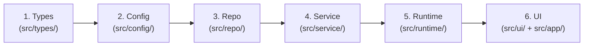
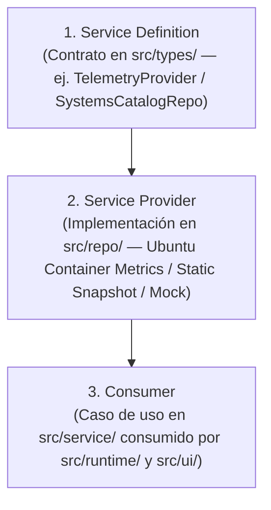

# ARCHITECTURE.md

Este documento es el mapa superior del sistema bajo el **Arnés Camaleón Universal v2.1** para el portafolio comercial de **Sebastián (`dekolabs.org`)**. Define qué dominios existen, cómo se aplica el perfil `greenfield` en `harness.config.json` para **Next.js 15 (App Router, TypeScript, Tailwind CSS) + Docker (`node:22-alpine`)** en el **Ubuntu Linux Home Lab**, qué capas pueden comunicarse entre sí y cómo se imponen mecánicamente las fronteras arquitectónicas.

## 1. Forma General del Sistema

- **Proyecto / Flujo de Trabajo:** `sebastian-web-portafolio` — Portafolio comercial y galería de sistemas en producción de **Sebastián (`Principal Software & AI Architect`)** bajo el dominio `https://dekolabs.org`, gobernado por el Arnés Camaleón Universal v2.1.
- **Flujo Principal del Sistema:** Recibe especificaciones secuenciales (`feature_list.json`) y construye la aplicación web en Next.js 15 (`output: 'standalone'`) basada en el sistema de diseño **Atelier Monolith** (Google Stitch `projects/10491405022475068698`), validada a través de **3 Puertas aditivas en orden estricto** (Estática -> Comportamiento -> Sistema Completo: `typecheck`, `lint`, `test`, `build`), preservando el repositorio limpio, con `0 CRLF` y reiniciable (`clean-state`).
- **Superficies de Ejecución:**
  1. **Aplicación Web & API (`dekolabs.org`)**: Next.js 15 App Router en `src/app/` y `src/ui/`, lógica y datos estructurados en `src/{types,config,repo,service,runtime}`, y contenedor Docker multi-stage en Ubuntu Linux Home Lab (puerto interno `3000` detrás de Reverse Proxy existente).
  2. **Arnés de Verificación**: Scripts POSIX (`init.sh`, `scripts/check-architecture.sh`) y validadores/runners CLI en Node.js (`scripts/validate-harness.mjs`, `scripts/harness-hooks.mjs`, `scripts/check-python.mjs`, `scripts/check-deliverables.mjs`).
- **Fuente de Verdad del Comportamiento:** `harness.config.json`, `feature_list.json`, `sprint-contract.md`, `ARCHITECTURE.md` y `docs/product-specs/dekolabs-portfolio-spec.md`.

## 2. Mapa de Dominios

| Dominio (Área) | Propósito (De qué es dueño) | Carpeta / Punto de Entrada | Especificación Relacionada |
| :--- | :--- | :--- | :--- |
| **Catálogo Administrable de Sistemas y Proyectos IA (`portfolio-catalog`)** | Modelos, repositorio PostgreSQL (`pgvector/pgvector:pg17`) con `Capability Seam`, servicios de catálogo dual (`SISTEMAS EN PRODUCCIÓN` y `MÁS PROYECTOS DE IA`), panel de administración (`/admin/proyectos`), subida de activos (`/api/admin/upload`, `/api/assets/[filename]`) y casos de estudio con galería de 3 imágenes (`/sistemas/[slug]`) | `src/types/`, `src/config/`, `src/repo/`, `src/service/`, `src/runtime/`, `src/ui/`, `src/app/sistemas/[slug]/`, `src/app/admin/proyectos/` | `docs/product-specs/dekolabs-portfolio-spec.md` |
| **Orquestación Agéntica & Stack Comercial (`agentic-stack`)** | Exhibición técnica del entorno de orquestación de agentes autónomos de Sebastián (Arnés Camaleón v2.1, flujo *Maker-Checker* `one-shot`, protocolo MCP, grafo DAG) y matriz de capacidades del stack para contratos e implementaciones | `src/types/`, `src/repo/`, `src/service/`, `src/ui/` | `docs/product-specs/dekolabs-portfolio-spec.md`, `graph.md`, `goal.md` |
| **Telemetría Ubuntu Home Lab & Contacto (`homelab-telemetry`)** | Telemetría en tiempo real/determinista del contenedor en Ubuntu Linux (`/api/telemetry`, `/api/health`), terminal interactiva en vivo y canal comercial de contacto (`/api/contact`) | `src/config/`, `src/repo/`, `src/service/`, `src/runtime/`, `src/app/api/` | `docs/product-specs/dekolabs-portfolio-spec.md`, `docs/RELIABILITY.md` |
| **Infraestructura & Contenedorización (`homelab-infra`)** | Empaquetado Next.js `standalone` en Docker multi-stage (`Dockerfile`, `docker-compose.yml`, `.dockerignore`, `.env.example`) optimizado para Ubuntu Server detrás de Reverse Proxy | `Dockerfile`, `docker-compose.yml`, `next.config.ts` | `docs/product-specs/dekolabs-portfolio-spec.md`, `docs/SECURITY.md` |
| **Gobernanza, Estado y Verificación del Arnés (`instructions`, `state`, `scope`, `lifecycle`, `verification`)** | Índice operativo (`AGENTS.md`), reglas `WIP = 1`, estado DAG (`feature_list.json`), contrato de sprint, Auto-Memoria (`memory/`), 3 puertas aditivas (`init.sh`), hooks `Fail-Closed` y rúbrica `Maker-Checker` | `AGENTS.md`, `harness.config.json`, `feature_list.json`, `sprint-contract.md`, `init.sh`, `scripts/`, `.agents/` | `AGENTS.md`, `docs/GOTCHAS.md` |

## 3. Modelo Estricto de Capas (Flujo Direccional Único) y Perfiles Camaleón

Para evitar que las sesiones de agentes introduzcan acoplamiento directo entre las vistas de Next.js y los datos/variables de entorno, todo el código en `src/` obedece esta dirección única de 6 capas:

`Types (Definiciones) -> Config (Ajustes) -> Repo (Datos/Archivos) -> Service (Lógica de Negocio) -> Runtime (Ejecución) -> UI (Interfaz/Salida)`

### Ubicación de Componentes en las 6 Capas (`dekolabs.org`)

| Capa | Responsabilidad en `dekolabs.org` | Carpetas en Código (`src/`) | Traducción en `mode: "non-dev"` | Artefactos del Arnés |
| :--- | :--- | :--- | :--- | :--- |
| **1. `Types`** | Contratos TypeScript puros: sistemas en producción, etapas de pipeline, pestañas de código, nodos agénticos, telemetría del Home Lab y consultas de contacto | `src/types/` (`layerMap.types`) | Glosarios, taxonomías y esquemas base | `scripts/feature-list.schema.json`, esquema de `harness.config.json`, `GraphState` en `graph.md` |
| **2. `Config`** | Metadatos del dominio `dekolabs.org`, perfil de marca personal de Sebastián, tokens del sistema visual *Atelier Monolith* y variables de entorno validadas del contenedor Ubuntu | `src/config/` (`layerMap.config`) | Parámetros del estudio y criterios de formato | `.gitignore`, `.gitattributes`, `harness.config.json`, `AGENTS.md`, `ARCHITECTURE.md`, `docs/SECURITY.md`, `.agents/hooks.json`, `goal.md` |
| **3. `Repo`** | Catálogo fuente de los 4 sistemas en producción, datos de arquitectura agéntica/stack y proveedor de lecturas del sistema operativo/contenedor Linux (`os`/`process`) | `src/repo/` (`layerMap.repo`) | Fuentes primarias verificables y datasets | Funciones I/O (`readText`, `readJson`, `writeText`, `loadHarnessFiles`) en `scripts/lib/harness-utils.mjs` |
| **4. `Service`** | Casos de uso puros: consulta y filtrado de sistemas por `slug`, ensamblaje de matriz agéntica, cálculo de instantáneas de telemetría del Home Lab y validación de solicitudes de clientes | `src/service/` (`layerMap.service`) | Síntesis y modelos de decisión | Funciones puras en `scripts/lib/harness-utils.mjs` y políticas `Fail-Closed` en `scripts/lib/harness-guards.mjs` |
| **5. `Runtime`** | Manejadores de endpoints HTTP (`health`, `telemetry`, `contact`), instrumentación de logs JSON `RuntimeLogEntry` con `correlationId` y orquestación del servidor | `src/runtime/` (`layerMap.runtime`) | Flujo de revisión y `scripts/check-deliverables.mjs` | `init.sh`, `scripts/check-architecture.sh`, `scripts/validate-harness.mjs`, `scripts/check-python.mjs`, `scripts/check-deliverables.mjs`, `scripts/harness-hooks.mjs` |
| **6. `UI`** | Sistema de diseño *Atelier Monolith* (Dark/Light), Header/Footer, Hero con telemetría, tarjetas de sistemas, vista profunda `/sistemas/[slug]`, módulo de orquestación agéntica y terminal interactiva | `src/ui/` y `src/app/` (`layerMap.ui`) | Reportes o entregables finales | Formateadores (`formatScoreReport`, `htmlReport`) en `scripts/lib/harness-utils.mjs` y salida Bolígrafo Rojo |

### Los 3 Perfiles Camaleón (`harness.config.json`) — Configuración Activa

1. **Perfil 1 — Código Nuevo y Políglota (`mode: "greenfield"`, activo en este proyecto)**:
   - `activeStacks`: `["node", "nextjs", "typescript", "tailwindcss", "docker"]`.
   - `scripts/check-architecture.sh` escanea `src/` y mapea `src/app/` y `src/ui/` a la capa `UI`. Las páginas y componentes en `src/app/` o `src/ui/` pueden importar desde `src/ui/`, `src/service/`, `src/runtime/` y `src/types/`, pero tienen **estrictamente prohibido** saltar hacia `src/config/` o `src/repo/`.
2. **Perfil 2 — Repositorios Existentes (`mode: "brownfield"` con Trinquete / *Ratchet*)**:
   - Desactivado (`brownfield.enabled: false`, `maxLegacyLayerViolations: 0`); no se tolera deuda de capas en código nuevo.
3. **Perfil 3 — Tareas de No-Desarrollo (`mode: "non-dev"`)**:
   - Reservado para proyectos puramente documentales (`scripts/check-deliverables.mjs` sigue validando `harness.config.json` en Puerta 3).

### Reglas Duras de Dependencia (Invariantes)

1. **Prohibido ir hacia atrás (`No Backward Dependencies`)**: Una capa inferior (`Types`, `Config`, `Repo`, `Service`) NUNCA puede depender ni importar de una capa superior (`Runtime`, `UI`), ni terminar el proceso directamente con `process.exit`.
2. **Prohibido saltar capas (`No Layer Skipping`)**: La interfaz (`UI`, incluyendo `src/ui/` y `src/app/`) puede consumir contratos puros de `Types`, pero NUNCA puede evadir `Service` o `Runtime` para acceder directamente a `Config` o `Repo` (incluso para leer metadatos del sitio o listas de proyectos: todo debe exponerse vía `src/service/`).
3. **Acceso a datos acotado y aislamiento de entorno**: Todo acceso a persistencia, catálogos o métricas del host Ubuntu ingresa por `Repo`; todo paquete Python (si se agregaran scripts auxiliares) se instala exclusivamente dentro de `.venv` local.
4. **Justificación de dependencias nuevas**: Toda nueva dependencia externa en `package.json` debe justificarse explícitamente en `sprint-contract.md` antes de incorporarse.
5. **Preocupaciones transversales (`Cross-Cutting Concerns`)**: Deben entrar únicamente a través de las fronteras explícitas de proveedor/adaptador definidas en la sección 5 (`docs/RELIABILITY.md`, `docs/SECURITY.md`).
6. **Validación Aditiva de Terminación en 3 Puertas (`3-Gate Verification`)**: Toda ejecución de `init.sh` debe superar en orden estricto Puerta 1 Estática (`bash scripts/check-architecture.sh`), Puerta 2 Comportamiento (`node scripts/validate-harness.mjs --min-score 100`) y Puerta 3 Sistema Completo (`npm run typecheck`, `npm run lint`, `npm test`, `npm run build` -> `CLEAN STATE`).
7. **Invariante de Bolígrafo Rojo (`Red-Pen Error Format`)**: Todo error emitido por un script de verificación o hook debe incluir tres partes obligatorias: `ERROR:` (qué falló y dónde), `POR QUÉ:` (qué invariante protege) y `SOLUCIÓN (FIX):` (acción exacta para repararlo sin adivinar).

## 4. Capability Seams (Costuras de Capacidad Intercambiables — DeepSeek Harness)

Tanto el arnés como los módulos de telemetría y contacto de `dekolabs.org` desacoplan la lógica de negocio de la infraestructura concreta mediante un **`Capability Seam`** de tres roles:

- **`Service Definition`**: Declara el contrato estable de una capacidad en `src/types/` (proveedor de telemetría del Home Lab, repositorio de sistemas en producción, despachador de contacto).
- **`Service Provider`**: Implementa ese contrato en `src/repo/` sobre el entorno real (lectura de métricas del contenedor Ubuntu Linux en producción vs. proveedor determinista en pruebas unitarias).
- **`Consumer`**: `src/service/`, `src/runtime/` y `src/ui/` consumen la capacidad uniforme sin acoplarse a detalles del host subyacente.

## 5. Interfaces Transversales (Cross-Cutting Interfaces)

| Preocupación | Límite / Adaptador Aprobado | Notas e Invariantes |
| :--- | :--- | :--- |
| **Logging y trazabilidad** | Esquema `RuntimeLogEntry` de `docs/RELIABILITY.md` + adaptador en `src/runtime/` y `.agents/.runtime/hook-audit.jsonl` | Salida JSON estructurada con `correlationId` y redacción de secretos (`redactSecrets`) en endpoints `/api/health`, `/api/telemetry` y `/api/contact`. Prohibido `console.log` no estructurado en `src/{types,config,repo,service}`. |
| **Autenticación y secretos** | Reglas de `docs/SECURITY.md` + validación en `src/config/` | Variables del contenedor documentadas en `.env.example`; archivos `.env*` ignorados en Git y bloqueados en `PreToolUse`. Ninguna credencial literal en el bundle cliente. |
| **APIs externas y MCP** | Clientes/proveedores en `src/repo/` bajo `Capability Seams` y herramientas MCP interceptadas en `.agents/hooks.json` | Timeouts explícitos, validación de entrada en formularios de contacto y políticas `Fail-Closed`. |
| **Perfiles y Tema Visual** | `harness.config.json` para el arnés y `src/config/` -> `src/service/` para configuración del sitio y tema *Atelier Monolith* | Soporte nativo Light/Dark (**Modo Claro `class="light"` por defecto** + conmutador a Modo Oscuro) fiel a los tokens de Google Stitch. |

## 6. Puntos Calientes Actuales (Current Hotspots)

Zonas del repositorio donde los cambios tienen mayor impacto estructural y exigen máxima cautela por parte de cada sesión nueva:

- **Frontera `src/app/` y `src/ui/` (`UI`) vs `src/config/` y `src/repo/`**: En Next.js es común importar constantes de `src/config/` o datos de `src/repo/` directamente dentro de `src/app/page.tsx` o `src/app/layout.tsx`. **En este repositorio eso dispara un error de Puerta 1 (`Salto ilegal de capas: UI importa hacia config/repo`)**. Toda lectura de metadatos, navegación o proyectos desde `src/app/` y `src/ui/` DEBE pasar por funciones exportadas en `src/service/` (o `src/runtime/`) y tipos en `src/types/`.
- **Rutas API de Next.js (`src/app/api/**/route.ts`)**: Al estar dentro de `src/app/`, el vigilante arquitectónico clasifica `src/app/api/**/route.ts` en la capa `UI` (o `Runtime` por el segmento `api`). Para evitar cualquier colisión de capas, los archivos `route.ts` deben delegar toda su ejecución a controladores en `src/runtime/` o servicios en `src/service/`, sin importar directamente `src/repo/` ni `src/config/`.
- **Invariante `0 CRLF` y `0 UTF-8 BOM` en Windows**: Al crear archivos `.ts`, `.tsx`, `.css`, `.json`, `Dockerfile` o `.yml`, deben guardarse siempre con fin de línea `LF` puro.
- **Tiempos de `init.sh` en el Hook `Stop`**: Mantener los tests unitarios (`vitest`) y el build de Next.js rápidos y deterministas para que `HARNESS_SKIP_INSTALL=1 bash ./init.sh` complete holgadamente dentro del timeout del hook `Stop`.

## 7. Lista de Verificación al Modificar la Arquitectura

Cuando modifiques código, perfiles o reglas relevantes para la arquitectura:

1. Actualiza `harness.config.json` y este `ARCHITECTURE.md` si el modo del proyecto, el `layerMap`, las 6 capas o las interfaces transversales cambiaron.
2. Registra el razonamiento arquitectónico y las alternativas descartadas (`Alternatives considered`) en `progress.md` y en `docs/product-specs/dekolabs-portfolio-spec.md`.
3. Ejecuta `bash scripts/check-architecture.sh` y `bash ./init.sh` verificando cero violaciones direccionales y formato de Bolígrafo Rojo.
