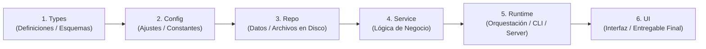
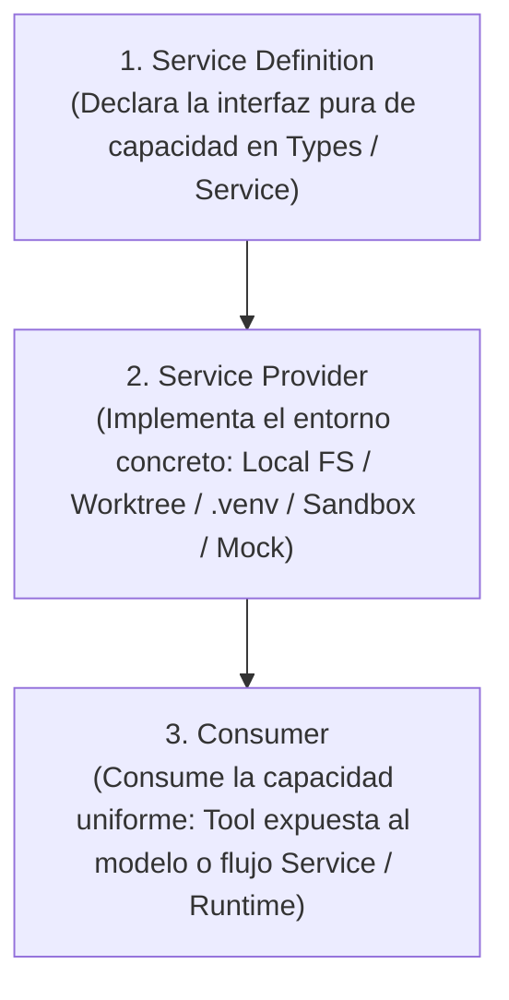

# ARCHITECTURE.md

Este documento es el mapa superior del sistema bajo el **Arnés Camaleón Universal v2.1**. Debe mantenerse conciso, definir qué dominios existen, cómo se adaptan los **3 Perfiles Camaleón (`harness.config.json`)** a proyectos nuevos, existentes o de no-desarrollo, qué capas pueden comunicarse entre sí y cómo se imponen mecánicamente las fronteras arquitectónicas.

## 1. Forma General del Sistema

- **Proyecto / Flujo de Trabajo:** Repositorio gobernado por el Arnés Camaleón Universal v2.1 para Agentes Autónomos de Larga Duración.
- **Flujo Principal del Sistema:** Recibe especificaciones secuenciales (`feature_list.json`) y produce entregables verificados (software políglota o entregables de conocimiento `non-dev`) a través de **3 Puertas aditivas en orden estricto** (Estática -> Comportamiento -> Sistema Completo / Entregables), preservando el repositorio limpio, con `0 CRLF` y reiniciable (`clean-state`).
- **Superficies de Ejecución:** Scripts POSIX (`init.sh`, `scripts/check-architecture.sh`), validadores y runners CLI en Node.js (`scripts/validate-harness.mjs`, `scripts/harness-hooks.mjs`, `scripts/check-python.mjs`, `scripts/check-deliverables.mjs`) y módulos o entregables del proyecto objetivo (`web`, `python`, `cli`, `desktop`, `services`, `powershell`, `flutter` o `non-dev`).
- **Fuente de Verdad del Comportamiento:** `harness.config.json`, `feature_list.json`, `sprint-contract.md`, `ARCHITECTURE.md` y `docs/product-specs/` (cuando exista en el proyecto).

## 2. Mapa de Dominios

| Dominio (Área) | Propósito (De qué es dueño) | Carpeta / Punto de Entrada | Especificación Relacionada |
| :--- | :--- | :--- | :--- |
| **Aplicación / Entregables (`app`)** | Módulos de código bajo las 6 capas estrictas (Web, Python, CLI, Políglota o `layerMap` *Brownfield*) o entregables estructurados de investigación/estrategia en modo `non-dev` | `src/`, `app/`, `backend/` (o rutas mapeadas en `harness.config.json`) | `harness.config.json`, `feature_list.json`, `sprint-contract.md`, `docs/product-specs/` |
| **Gobernanza e Instrucciones (`instructions`)** | Índice operativo del agente (~105 líneas), autoconfiguración Día 1, escalado, reglas `WIP = 1`, prompts `Maker-Checker`, Skill bajo demanda, grafo de 5 nodos y mapa arquitectónico | `AGENTS.md`, `ARCHITECTURE.md`, `harness.config.json`, `goal.md`, `maker-prompt.md`, `checker-prompt.md`, `.agents/skills/maker-checker/SKILL.md`, `graph.md` | `AGENTS.md` |
| **Estado, Alcance y Ciclo de Vida (`state`, `scope`, `lifecycle`)** | Estado secuencial de tareas (`not-started`, `in-progress`, `blocked`, `done`), contrato de sprint, estado entre rondas con Trinquete (*Ratchet*) y 4 disyuntores, evidencia ejecutable, progreso y entrega de turno | `feature_list.json`, `sprint-contract.md`, `loop-state.md`, `progress.md`, `session-handoff.md`, `clean-state-checklist.md` | `clean-state-checklist.md` |
| **Auto-Memoria Persistente (`memory`)** | Retención de contexto no derivable del código bajo el Invariante de Guardado en Dos Pasos, exclusión mutua y límite duro de 200 líneas / 25 KB | `memory/INDEX.md`, `memory/topics/` | `memory/INDEX.md` |
| **Verificación, Límites Mecánicos, Seguridad y Observabilidad Dual (`verification`)** | Higiene `0 CRLF`, esquema JSON canónico, validación aditiva en 3 puertas (Node/Web + Python `.venv`/AST + Documental `non-dev`), auditoría `100/100`, Bolígrafo Rojo, `Fail-Closed`, anti-`pip` global, hooks nativos + `hook-audit.jsonl`, rúbrica Checker (`0-12`), semáforo (`A-D`) y 15 Gotchas | `.gitignore`, `.gitattributes`, `scripts/feature-list.schema.json`, `init.sh`, `scripts/check-architecture.sh`, `scripts/validate-harness.mjs`, `scripts/check-python.mjs`, `scripts/check-deliverables.mjs`, `scripts/harness-hooks.mjs`, `scripts/lib/harness-utils.mjs`, `scripts/lib/harness-guards.mjs`, `docs/RELIABILITY.md`, `docs/SECURITY.md`, `.agents/hooks.json`, `evaluator-rubric.md`, `docs/QUALITY_SCORE.md`, `docs/GOTCHAS.md` | `docs/GOTCHAS.md` |

## 3. Modelo Estricto de Capas (Flujo Direccional Único) y Perfiles Camaleón

Para evitar que los agentes inventen arquitectura *ad hoc* o código espagueti, el trabajo dentro de cada dominio sigue esta dirección única de 6 capas:

`Types (Definiciones) -> Config (Ajustes) -> Repo (Datos/Archivos) -> Service (Lógica de Negocio) -> Runtime (Ejecución) -> UI (Interfaz/Salida)`

### Ubicación de Componentes en las 6 Capas

| Capa | Responsabilidad | Carpetas en Código (Web / Python / Políglota) | Traducción en `mode: "non-dev"` | Artefactos del Arnés |
| :--- | :--- | :--- | :--- | :--- |
| **1. `Types`** | Contratos de datos, esquemas e interfaces puras (`Service Definitions`) sin dependencias superiores | `src/types/`, `app/types/`, `backend/types/` (o `layerMap.types`) | Glosarios, taxonomías, esquemas de evaluación y definiciones base | `scripts/feature-list.schema.json`, esquema de `harness.config.json`, `GraphState` en `graph.md` |
| **2. `Config`** | Variables de entorno validadas, *feature flags*, perfiles y constantes que solo dependen de `Types` | `src/config/`, `app/config/`, `backend/config/` (o `layerMap.config`) | Parámetros del estudio, restricciones de alcance y criterios de formato | `.gitignore`, `.gitattributes`, `harness.config.json`, `AGENTS.md`, `ARCHITECTURE.md`, `docs/SECURITY.md`, `.agents/hooks.json`, `goal.md` |
| **3. `Repo`** | Acceso a bases de datos, APIs externas, sistema de archivos o `Service Providers` concretos | `src/repo/`, `app/repo/`, `backend/repo/` (o `layerMap.repo`) | Fuentes primarias verificables, datasets crudos, bibliografía y citas | Funciones I/O (`readText`, `readJson`, `writeText`, `loadHarnessFiles`) en `scripts/lib/harness-utils.mjs` |
| **4. `Service`** | Reglas puras de negocio, transformaciones y validación sin acoplarse a `Runtime` ni `UI` | `src/service/`, `app/service/`, `backend/service/` (o `layerMap.service`) | Análisis comparativo, síntesis, modelos de decisión y argumentación | Funciones puras en `scripts/lib/harness-utils.mjs` y políticas `Fail-Closed` en `scripts/lib/harness-guards.mjs` |
| **5. `Runtime`** | *Bootstrap*, servidores, workers, rutas API/CLI, runner de hooks y orquestación de las 3 puertas | `src/runtime/`, `app/runtime/`, `backend/runtime/` (o `layerMap.runtime`) | Flujo de compilación/revisión y validación con `scripts/check-deliverables.mjs` | `init.sh`, `scripts/check-architecture.sh`, `scripts/validate-harness.mjs`, `scripts/check-python.mjs`, `scripts/check-deliverables.mjs`, `scripts/harness-hooks.mjs` |
| **6. `UI`** | Vistas web, componentes visuales, formateadores CLI o documentos finales listos para el lector humano | `src/ui/` y superficies web mapeadas (`components`, `pages`, `views`, `app`, `routes`, `.astro/.vue/.svelte/.mdx`) | Reportes ejecutivos, manuales, propuestas o entregables finales limpios | Formateadores (`formatScoreReport`, `htmlReport`) en `scripts/lib/harness-utils.mjs` y salida Bolígrafo Rojo |

### Los 3 Perfiles Camaleón (`harness.config.json`) — Autoconfiguración Día 1

El agente inspecciona el workspace el Día 1 y configura `harness.config.json` sin intervención técnica del usuario bajo uno de estos tres perfiles:

1. **Perfil 1 — Código Nuevo y Políglota (`mode: "auto"` o `"greenfield"`)**:
   - **Stacks Web modernos**: `scripts/check-architecture.sh` escanea `src/` y `app/`, soporta `.js/.mjs/.cjs/.ts/.tsx/.jsx` más `.astro`, `.vue`, `.svelte` y `.mdx`, detecta `import(\`...\`)` con *template literals* y alias (`@repo/*`, `#config/*`), y mapea automáticamente carpetas frontend (`components`, `pages`, `views`, `app`, `routes`) a las reglas de `UI` (permitiendo importar componentes y `Service`/`Runtime`/`Types`, pero bloqueando saltos directos a `Config` o `Repo`).
   - **Paquetes Python y Repositorios Mixtos (`python.packageRoots: ["src", "app", "backend"]`)**: En repositorios con `pyproject.toml`, `requirements.txt` o archivos `.py`, la Puerta 3 ejecuta aditivamente `node scripts/check-python.mjs` (incluso junto a `package.json`), exigiendo aislamiento `requireVenvForPip` (`.venv`), sintaxis AST limpia (`enforceAstChecks`), detección AST de secretos quemados, respeto de capas en imports absolutos/relativos y pruebas `pytest`.
2. **Perfil 2 — Repositorios Existentes (`mode: "brownfield"` con Trinquete / *Ratchet*)**:
   - En lugar de forzar una reescritura masiva el Día 1 o ignorar carpetas heredadas con un falso verde, el agente activa `brownfield.enabled: true` y mapea las carpetas reales del proyecto dentro de `layerMap` en `harness.config.json` (con soporte de `brownfield.allowUnmappedDirs` y `allowEmptyDirs`).
   - Si el código legado ya contiene $N$ violaciones direccionales previas, el agente mide el conteo base real y lo fija en `brownfield.maxLegacyLayerViolations: N`. `scripts/check-architecture.sh` y `scripts/check-python.mjs` **bloquean inmediatamente cualquier violación nueva (`> N`)** y operan como trinquete (*Ratchet*): a medida que se sanea deuda heredada, `maxLegacyLayerViolations` solo puede disminuir hacia `0`.
3. **Perfil 3 — Tareas de No-Desarrollo (`mode: "non-dev"`)**:
   - Para proyectos de investigación, documentación técnica, auditoría, estrategia de negocio o análisis donde no existe código de aplicación, el agente fija `"mode": "non-dev"` y organiza las rutas en `nonDev.deliverableDirs` (`deliverables`, `content`, `research`, `reports`) y `feature_list.json` (`required_files`).
   - `init.sh` activa la **Puerta 3 Documental (`node scripts/check-deliverables.mjs`)**, bloqueando el cierre si detecta marcadores incompletos (`forbidPlaceholders`: `[PENDIENTE]`, `TODO:`, `[TODO]`, `TBD`, `FIXME`, `Lorem ipsum`), enlaces o imágenes locales rotas (`checkMarkdownLinks`), sustancia insuficiente (`minDeliverableWords`) o ausencia de fuentes verificables.

### Reglas Duras de Dependencia (Invariantes)

1. **Prohibido ir hacia atrás (`No Backward Dependencies`)**: Una capa inferior (`Types`, `Config`, `Repo`, `Service`) NUNCA puede depender ni importar de una capa superior (`Runtime`, `UI`), ni terminar el proceso directamente con `process.exit`.
2. **Prohibido saltar capas (`No Layer Skipping`)**: La interfaz (`UI`, incluyendo `components`, `pages`, `app` y `.astro/.vue/.svelte`) puede consumir contratos puros de `Types`, pero NUNCA puede evadir `Service` o `Runtime` para acceder directamente a `Config` o `Repo`.
3. **Acceso a datos acotado y aislamiento de entorno**: Todo acceso a persistencia o sistemas externos ingresa por `Repo`; todo paquete Python se instala exclusivamente dentro de `.venv` local (candado anti-`pip` global activo).
4. **Justificación de dependencias nuevas**: Toda nueva dependencia externa debe justificarse explícitamente en `sprint-contract.md` o en el documento de diseño activo antes de incorporarse.
5. **Preocupaciones transversales (`Cross-Cutting Concerns`)**: Deben entrar únicamente a través de las fronteras explícitas de proveedor/adaptador definidas en la sección 5 (`docs/RELIABILITY.md`, `docs/SECURITY.md`).
6. **Validación Aditiva de Terminación en 3 Puertas (`3-Gate Verification`)**: Toda ejecución de `init.sh` debe superar en orden estricto Puerta 1 Estática (`bash scripts/check-architecture.sh`), Puerta 2 Comportamiento (`node scripts/validate-harness.mjs --min-score 100`) y Puerta 3 Sistema Completo Políglota / Documental (`CLEAN STATE`).
7. **Invariante de Bolígrafo Rojo (`Red-Pen Error Format`)**: Todo error emitido por un script de verificación o hook debe incluir tres partes obligatorias: `ERROR:` (qué falló y dónde), `POR QUÉ:` (qué invariante protege) y `SOLUCIÓN (FIX):` (acción exacta para repararlo sin adivinar).

## 4. Capability Seams (Costuras de Capacidad Intercambiables — DeepSeek Harness)

El arnés y la aplicación nunca deben acoplar las reglas de negocio ni las herramientas del agente a un proveedor rígido; en su lugar, estandarizan cada capacidad externa o de entorno como un **`Capability Seam`** de tres roles:

- **`Service Definition`**: Declara el contrato estable de una capacidad (sistema de archivos, ejecutor de subprocesos, entorno Python `.venv`, validador documental, cliente API/MCP o sub-agentes).
- **`Service Provider`**: Implementa ese contrato sobre una infraestructura concreta (`Local FS` vs. `git worktree` aislado vs. `Sandbox remoto` vs. proveedor `In-Memory` para tests deterministas).
- **`Consumer`**: Utiliza la interfaz sin conocer qué `Provider` está montado debajo, preservando idéntica la superficie de herramientas y la `prompt cache`.

## 5. Interfaces Transversales (Cross-Cutting Interfaces)

| Preocupación | Límite / Adaptador Aprobado | Notas e Invariantes |
| :--- | :--- | :--- |
| **Logging y trazabilidad** | Esquema `RuntimeLogEntry` de `docs/RELIABILITY.md` + auditoría real en `.agents/.runtime/hook-audit.jsonl` y adaptador en `Runtime` | Solo salida JSON estructurada con `correlationId` y redacción automática de secretos/PII (`redactSecrets`); prohibido `console.log` no estructurado en dominio. |
| **Autenticación y secretos** | Reglas de `docs/SECURITY.md` + carga validada en `Config` tras cruzar la frontera de confianza | Credenciales inyectadas por entorno (`.env.example` documentado; `.env*` ignorado en Git y bloqueado por `PreToolUse` en escritura directa, MCP y shell). |
| **APIs externas y MCP** | Clientes/proveedores en `Repo` bajo `Capability Seams` y herramientas MCP interceptadas en `.agents/hooks.json` | *Timeouts* explícitos, *backoff*, permisos `Fail-Closed` (`call_mcp_tool` y `mcp_.*` inspeccionados en `harness-guards.mjs`) y validación de entrada no confiable. |
| **Perfiles y Feature flags** | `harness.config.json` y frontera centralizada en `Config` | Propiedad clara del modo operativo (`auto`/`greenfield`, `brownfield`, `non-dev`), trinquete explícito y estado por defecto `Fail-Closed`. |

## 6. Puntos Calientes Actuales (Current Hotspots)

Zonas del repositorio donde los cambios tienen mayor impacto estructural o riesgo de regresión y exigen máxima cautela:

- **`scripts/check-architecture.sh`, `init.sh` y `harness.config.json` (`set -euo pipefail`)**: Gobiernan las 3 Puertas aditivas, el mapeo `layerMap`, el trinquete `maxLegacyLayerViolations` y la verificación `0 CRLF`. Cualquier desajuste de esquema o código de salida no controlado bloquea el arranque y el hook `Stop`.
- **`scripts/check-python.mjs` y `scripts/check-deliverables.mjs`**: Ejecutan la verificación profunda de entornos Python (`.venv`, AST, capas, `pytest`) y la Puerta 3 Documental para proyectos `non-dev`; deben emitir diagnósticos Bolígrafo Rojo deterministas y rápidos.
- **`scripts/lib/harness-utils.mjs`, `scripts/lib/harness-guards.mjs` y `scripts/feature-list.schema.json`**: Núcleo puro (`Repo`/`Service`) del puntaje `100/100`, `structuredHas`, paridad de esquema (`evidence >= 10` caracteres, cero `../` fuera de raíz) y políticas `Fail-Closed` (anti-`pip` global, MCP, aislamiento de rúbrica y Candado 3 `one-shot`). Prohibido invocar `process.exit` desde `scripts/lib/`.
- **`AGENTS.md` (`Required Artifacts` y reglas estructuradas)**: Enlazar en `Required Artifacts` un archivo inexistente dispara el detector Anti-`Doc Bloat`, y mover reglas estructuradas a párrafos de prosa invalida `structuredHas`.
- **`.agents/hooks.json` y `scripts/harness-hooks.mjs` (`<= 280` líneas)**: Orquestan en milisegundos `PreToolUse`, `PostToolUse` y `Stop` (incluyendo Puerta 1 en `Stop` con árbol limpio y trazas `hook-audit.jsonl`).

## 7. Lista de Verificación al Modificar la Arquitectura

Cuando modifiques código, perfiles o reglas relevantes para la arquitectura:

1. Actualiza `harness.config.json` y este `ARCHITECTURE.md` si el modo del proyecto (`greenfield`, `brownfield`, `non-dev`), el `layerMap`, las 6 capas o las interfaces transversales cambiaron.
2. Registra el razonamiento arquitectónico y las alternativas descartadas (`Alternatives considered`) en `progress.md` y, cuando exista `docs/design-docs/`, actualiza el documento de diseño correspondiente.
3. Agrega o actualiza la verificación ejecutable correspondiente en `scripts/check-architecture.sh`, `scripts/check-python.mjs` o `scripts/check-deliverables.mjs` con formato de Bolígrafo Rojo.
