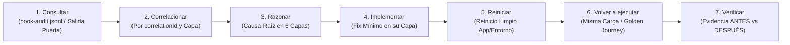

# RELIABILITY.md (Observabilidad de Runtime, Fiabilidad Aditiva en 3 Puertas y Validación UI / Non-Dev)

Este documento define cómo el **Arnés Camaleón Universal v2.1** demuestra de forma determinista que el repositorio está saludable, registra señales observables reales en disco y permanece reiniciable (`restartable`), eliminando suposiciones y reintentos a ciegas (*blind retries*) en aplicaciones Web/Node, backends Python, proyectos políglotas, repositorios `brownfield` y entregables `non-dev`.

---

## 1. Las 4 Rutas Estándar y Señales Requeridas en Tiempo de Ejecución

Todo proyecto gobernado por este arnés expone cuatro rutas operativas canónicas que cualquier sesión nueva puede ejecutar sin configuración manual:

| Ruta Estándar | Comando / Procedimiento Canónico | Propósito Operativo |
| :--- | :--- | :--- |
| **1. Arranque (`Startup`)** | `bash ./init.sh` | Confirma directorio, perfil `harness.config.json` (`validateHarnessConfig`), integridad de artefactos críticos (`0 CRLF`, `0 UTF-8 BOM`), sincronización inteligente y salud de línea base antes de editar. |
| **2. Verificación (`Verification`)** | `bash ./init.sh` (`check-architecture.sh` + `validate-harness.mjs` + `check-python.mjs` / `check-deliverables.mjs` / build & tests) | Ejecuta secuencialmente las 3 Puertas aditivas (Estática, Comportamiento `100/100` y Sistema Completo Políglota o Documental). |
| **3. Iniciar aplicación o servicio (`Start app / service`)** | `RUN_START_COMMAND=1 bash ./init.sh` (o `START_CMD` configurado en `harness.config.json` / entorno) | Levanta la aplicación o servicio objetivo únicamente después de haber superado en verde las 3 puertas de verificación previas. |
| **4. Depurar o inspeccionar runtime (`Debug / inspect runtime`)** | Inspección de `.agents/.runtime/hook-audit.jsonl` y logs de aplicación filtrando por `correlationId` / `level: "error"` + corrida aislada de la puerta afectada | Permite diagnosticar la causa raíz y la capa propietaria del fallo desde señales locales reales antes de modificar archivos. |

### Señales Requeridas en Tiempo de Ejecución (`Required Runtime Signals`)
Está estrictamente prohibido emitir mensajes vagos como `"Algo salió mal"` o `"Fallo inesperado"`. El runtime del arnés y de la aplicación proporcionan cuatro señales observables:
1. **Logs JSONL estructurados reales (`RuntimeLogEntry`)**: El runner `scripts/harness-hooks.mjs` (configurado en `.agents/hooks.json` con `PreInvocation` plano, `"matcher": "*"` en `PreToolUse`, `PostToolUse` sobre herramientas mutadoras y `Stop` plano) persiste cada evaluación en `.agents/.runtime/hook-audit.jsonl`, y los módulos de `Runtime` de la aplicación siguen el mismo contrato.
2. **Verificaciones de salud (`health checks`)**: Validación centralizada de `harness.config.json` mediante `validateHarnessConfig` en las 3 puertas, `.venv` y AST en Python (`scripts/check-python.mjs`), sintaxis JSON estricta, integridad de enlaces/sustancia (`scripts/check-deliverables.mjs`) y disponibilidad de dependencias.
3. **Datos de traza y latencia (`durationMs`)**: Medición explícita por evento/etapa (`PostToolUse < 15 ms`, `allowRubric` perezoso en `PreToolUse` y ejecución completa de `HARNESS_SKIP_INSTALL=1 bash ./init.sh` con `timeout: 45s` en `Stop` tanto con árbol sucio como con árbol limpio).
4. **Estados de error accionables con Bolígrafo Rojo (`ERROR + POR QUÉ + SOLUCIÓN`)**: Con secretos, tokens y `PII` redactados automáticamente según `docs/SECURITY.md`.

---

## 2. Esquema Obligatorio de Logs JSON Estructurados (`RuntimeLogEntry` y `hook-audit.jsonl`)

Cada paso crítico de ejecución en hooks del arnés (`.agents/.runtime/hook-audit.jsonl`) o en módulos `Runtime` del proyecto registra un **objeto JSON estructurado** con los siguientes 8 campos obligatorios:

| Campo | Tipo | Obligatorio | Descripción y Propósito |
| :--- | :--- | :--- | :--- |
| `timestamp` | `string` (ISO 8601) | Sí | Fecha y hora exacta en UTC (ej. `"2026-11-07T16:10:00.000Z"`). |
| `level` | `"info" \| "warn" \| "error"` | Sí | Nivel de severidad del evento (`"warn"`/`"error"` en bloqueos `deny` o `continue`). |
| `component` | `string` | Sí | Módulo emisor (ej. `"HarnessHooks"`, `"PythonChecker"`, `"DeliverablesChecker"`, `"ArchitectureChecker"`). |
| `action` | `string` | Sí | Operación específica evaluada (ej. `"pre-tool-use"`, `"stop"`, `"verificar_python_venv"`, `"auditar_entregables"`). |
| `durationMs` | `number` | Sí | Tiempo de ejecución en milisegundos para vigilar latencia de hooks y puertas. |
| `input` | `object \| string` | Sí | Resumen sanitizado y redactado de los parámetros de entrada (sin secretos ni payloads masivos). |
| `output` / `error` | `object \| null` | Sí | Decisión estructurada en éxito (`output`) o detalle exacto del fallo (`error` con `message`, `why` y `fix`). |
| `correlationId` | `string` | Sí | Identificador único por invocación, turno o solicitud (ej. `"hook-9c41f2"` o `"req-8f2a1c"`) para correlacionar eventos de extremo a extremo. |

### Ejemplo Canónico: Decisión Registrada en `.agents/.runtime/hook-audit.jsonl` (`level: "info"`)

```json
{
  "timestamp": "2026-11-07T16:10:04.120Z",
  "level": "info",
  "component": "HarnessHooks",
  "action": "stop",
  "durationMs": 310,
  "input": {
    "scriptToRun": "init.sh",
    "isGitClean": true
  },
  "output": {
    "decision": "stop",
    "gates": "1-3 PASS",
    "overallScore": 100
  },
  "error": null,
  "correlationId": "hook-9c41f2"
}
```

### Ejemplo Canónico: Evento de Fallo con Bolígrafo Rojo (`level: "error"`)

```json
{
  "timestamp": "2026-11-07T16:10:05.305Z",
  "level": "error",
  "component": "HarnessHooks",
  "action": "pre-tool-use",
  "durationMs": 4,
  "input": {
    "toolName": "run_command",
    "commandLine": "pip install requests"
  },
  "output": {
    "decision": "deny"
  },
  "error": {
    "message": "Instalación global de paquetes Python bloqueada ('pip install requests').",
    "why": "docs/SECURITY.md prohíbe contaminar el Python global del sistema fuera de un entorno virtual aislado (.venv).",
    "fix": "Crea o usa el entorno virtual del proyecto ('.venv/Scripts/python.exe -m pip install ...' o '.venv/bin/python -m pip install ...')."
  },
  "correlationId": "hook-9c41f3"
}
```

---

## 3. Contrato de Fiabilidad Aditiva en 3 Puertas (`init.sh`) y Recorridos Dorados (`Golden Journeys`)

Ningún cambio en el repositorio se considera fiable hasta superar secuencialmente las **3 Puertas de Verificación** ejecutadas por `bash ./init.sh` (`set -euo pipefail`, y ejecutadas también en `Stop` mediante `HARNESS_SKIP_INSTALL=1 bash ./init.sh` con `timeout: 45s` tanto con árbol sucio como con árbol limpio) y parametrizadas por `harness.config.json` (validado centralizadamente por `validateHarnessConfig` en las 3 puertas):

1. **Puerta 1 — Estática, `0 CRLF` / `0 BOM`, JSON Estricto y Límites Arquitectónicos (`Static & Architecture Gate`)**:
   - Verifica la existencia física de los archivos vitales, `0 CRLF` (`\r`) y `0 UTF-8 BOM` (`0xEF 0xBB 0xBF`) en todos los archivos de texto, sintaxis válida en todos los `.json` estrictos del árbol y ejecuta `bash scripts/check-architecture.sh` validando `ARCHITECTURE.md`, `harness.config.json` (`validateHarnessConfig`), las 6 capas (incluyendo superficies web `.astro/.vue/.svelte`, `components/`, `pages/`, `app/` y el trinquete `maxLegacyLayerViolations` en `brownfield`), Auto-Memoria (`<= 200L / 25KB`), cero enlaces muertos en `Required Artifacts` y `cleanup-scanner`.
2. **Puerta 2 — Comportamiento y Reglas de Subsistemas (`Behavioral Gate`)**:
   - Ejecuta `node scripts/validate-harness.mjs --min-score 100` validando centralizadamente `harness.config.json` (`validateHarnessConfig`) y exigiendo `100/100` (`25/25 PASS`) en `instructions`, `state`, `verification`, `scope` y `lifecycle`, validando `WIP <= 1`, orden secuencial DAG sin ciclos y `Pass-State Gating` en paridad estricta con `scripts/feature-list.schema.json` (`evidence >= 10` caracteres, cero `../` fuera de raíz y `required_files` físicos con tamaño `> 0`).
3. **Puerta 3 — Sistema Completo Políglota Aditivo y Puerta Documental (`End-to-End Polyglot & Non-Dev Gate`)**:
   - A diferencia de una cascada excluyente donde `package.json` silenciaba otros lenguajes, la Puerta 3 valida primero `harness.config.json` (`validateHarnessConfig`) y ejecuta **de forma aditiva** cada validador aplicable al repositorio:
     - **Node / Web (`package.json`)**: Instala dependencias solo en arranque en frío (cuando falta `node_modules/` o `HARNESS_FORCE_INSTALL=1`, omitiendo en `Stop` mediante `HARNESS_SKIP_INSTALL=1`) y corre `check`/`typecheck`, `lint`, `test` y `build`.
     - **Python (`scripts/check-python.mjs`)**: Cuando existen manifiestos o módulos Python (`pyproject.toml`, `requirements.txt`, `src/`, `app/`, `backend/`), verifica el aislamiento en `.venv`, parsea sintaxis/AST (incluyendo literales/secretos en argumentos por defecto, `f-strings` y `os.environ`) e imports de capas y ejecuta `pytest` / `unittest` / linters configurados.
     - **Otros Stacks Políglotas**: Ejecuta aditivamente Go (`go test`), Rust (`cargo test`), JVM (Maven/Gradle), .NET (`dotnet test`), Dart/Flutter, AST de PowerShell (`.ps1`) o los comandos declarados en `harness.config.json` / `VERIFY_CMD`.
     - **No-Desarrollo (`scripts/check-deliverables.mjs`)**: Cuando `mode: "non-dev"` (o existen entregables documentales registrados en `harness.config.json`), verifica tamaño y estructura real (`countRealWords` inmune a comentarios HTML, tablas vacías o URLs), cero placeholders (`[PENDIENTE]`, `TODO`, `TBD`, `Lorem ipsum`), cero enlaces o imágenes locales rotas y presencia de referencias/fuentes verificables.

### Recorridos Dorados (`Golden Journeys`)

| ID | Recorrido Dorado (`Golden Journey`) | Ruta de Verificación Repetible | Señal de Éxito Esperada | Señal Clara de Fallo |
| :--- | :--- | :--- | :--- | :--- |
| **`GJ-01`** | **Arranque en frío, `0 CRLF`/`0 BOM` y salud integral en 3 puertas** | `bash ./init.sh` | Código `0`, `0 CRLF`, `0 BOM`, `Overall: 100/100` (`25/25 PASS`) y cierre `CLEAN STATE`. | Parada inmediata (`Exit != 0`) con diagnóstico `ERROR + POR QUÉ + SOLUCIÓN`. |
| **`GJ-02`** | **Transición de tarea bajo `WIP = 1`, DAG y `Pass-State Gating`** | `node scripts/validate-harness.mjs --min-score 100` + `bash scripts/check-architecture.sh` | Máximo 1 tarea `in-progress`, dependencias en `done`, `required_files` no vacíos y `evidence >= 10` chars al cerrar. | Puntaje `< 100/100` o violación de esquema JSON. |
| **`GJ-03`** | **Entrega limpia, auditoría de hooks y reinicio (`Clean Handoff`)** | Inspección de `.agents/.runtime/hook-audit.jsonl` + `progress.md` + `session-handoff.md` + `bash ./init.sh` | Cero temporales, trazas `RuntimeLogEntry` válidas con `correlationId` y `HARNESS_SKIP_INSTALL=1 bash ./init.sh` (`timeout: 45s`) en `Stop` en verde en árbol sucio y limpio. | Bloqueo `"decision": "continue"` en `Stop` o alerta de `cleanup-scanner`. |
| **`GJ-04`** | **Adaptación Camaleón (`Políglota` / `Brownfield` / `non-dev`)** | `node scripts/check-python.mjs` y/o `node scripts/check-deliverables.mjs` vía `bash ./init.sh` | `.venv` aislado y AST/tests limpios en Python; trinquete `<= maxLegacyLayerViolations` en `brownfield`; cero placeholders/enlaces rotos en `non-dev`. | Fallo aditivo en Puerta 3 o incremento del trinquete de capas heredadas. |
| **`GJ-APP`** | **Flujos críticos de usuario del producto o entregable** | Comandos E2E / integración del dominio registrados al avanzar el proyecto | Respuesta válida, `RuntimeLogEntry` con `correlationId` y persistencia verificada tras reiniciar. | Excepción en logs estructurados, regresión funcional o enlaces/datos rotos. |

---

## 4. Bucle de Depuración de Observabilidad en 7 Pasos (`SOP observability-feedback-loop`)

Cuando ocurre un fallo en tiempo de ejecución, en un hook o en cualquiera de las 3 Puertas, el agente opera sobre las señales locales reales (salida Bolígrafo Rojo, `.agents/.runtime/hook-audit.jsonl` y logs de aplicación) siguiendo este bucle de **7 pasos**:



1. **Consultar (`query`)**: Leer la salida exacta de la puerta fallida y filtrar `.agents/.runtime/hook-audit.jsonl` o logs del servicio por `level: "error"` y `durationMs`.
2. **Correlacionar (`correlate`)**: Agrupar los pasos de la operación mediante `correlationId` para ubicar la frontera exacta donde falló el contrato.
3. **Razonar (`reason`)**: Identificar qué capa (`Types -> Config -> Repo -> Service -> Runtime -> UI`) es propietaria del defecto antes de editar.
4. **Implementar (`implement`)**: Aplicar la corrección mínima en la capa responsable sin relajar validadores, sin subir `maxLegacyLayerViolations` y manteniendo `WIP = 1`.
5. **Reiniciar (`restart`)**: Reiniciar limpiamente el servicio, `.venv` o proceso afectado para descartar estado residual en memoria.
6. **Volver a ejecutar (`re-run`)**: Correr exactamente la misma carga o Recorrido Dorado que disparó el fallo más `bash ./init.sh`.
7. **Verificar (`verify`)**: Confirmar con evidencia ejecutable (`ANTES` vs. `DESPUÉS`) que la señal de error desapareció y el repositorio quedó en `clean-state`.

**Invariantes Permanentes de Fiabilidad:**
- **Fallo Rápido (`Fail-Fast`) y Cero Reintentos a Ciegas**: Prohibido re-ejecutar un comando fallido sin leer el diagnóstico y corregir la causa raíz.
- **Frontera Honesta Local vs. Host**: La telemetría de herramientas/puertas vive localmente en `.agents/.runtime/hook-audit.jsonl`, mientras que las métricas internas de consumo de tokens del modelo residen en el host de Antigravity (`docs/SECURITY.md`).
- **Barrera ante fallos repetidos**: Si un modo de fallo reaparece, conviértelo en prueba automatizada o regla mecánica en `scripts/check-architecture.sh`, `scripts/check-python.mjs` o `scripts/check-deliverables.mjs`.

---

## 5. Validación de UI / Frontend con Chrome DevTools (Proyectos con Interfaz Gráfica)

Cuando el proyecto incluya interfaz gráfica (web, móvil o escritorio en `src/ui/`, `src/components/`, `src/pages/` o `app/`), la inspección estática del código es insuficiente:

### Principios de UI y los 5 Estados Visibles Clave
- **Claridad, consistencia y accesibilidad (`a11y`)**: Semántica DOM, etiquetas accesibles, foco visible, navegación completa por teclado y contraste forman parte de la verificación estándar de cada tarea.
- **Cobertura obligatoria de los 5 estados visibles**:
  1. **`vacío` (`empty`)**: Estado inicial comprensible cuando aún no existen datos.
  2. **`cargando` (`loading`)**: Retroalimentación inmediata bloqueando envíos duplicados.
  3. **`éxito` (`success`)**: Renderizado fiel de datos confirmados y transición predecible.
  4. **`error` (`error`)**: Mensaje claro y sanitizado ante fallos recuperables (cero fallos silenciosos).
  5. **`reintento` (`retry`)**: Acción directa para reintentar sin perder el trabajo del usuario.

### Bucle Principal de Validación con Chrome DevTools (8 Pasos `ANTES / DESPUÉS`)
Con `START_CMD` activo y criterios observables definidos:
1. **Seleccionar la página objetivo** activa.
2. **Limpiar el ruido previo de consola** antes de iniciar la prueba.
3. **Capturar el estado `ANTES`** (instantánea DOM, captura visual y red/consola base).
4. **Disparar una sola ruta de UI** a la vez para aislar causa y efecto.
5. **Observar eventos en vivo** (consola, peticiones HTTP y mutaciones DOM).
6. **Capturar el estado `DESPUÉS`** (redactando tokens o `PII` en capturas y trazas).
7. **Corregir en la capa responsable más pequeña** (`Types -> Config -> Repo -> Service -> Runtime -> UI`) y reiniciar si corresponde.
8. **Re-ejecutar la ruta** comparando `ANTES` vs. `DESPUÉS` hasta lograr estado visible correcto, cero errores inesperados, consola limpia y reproducibilidad exacta.
