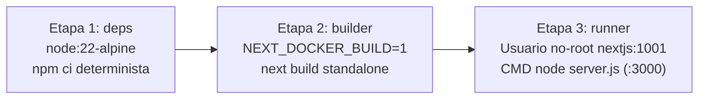
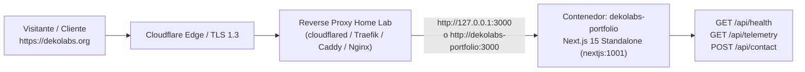

# Guía Operativa de Despliegue — `dekolabs.org` en Ubuntu Linux Home Lab

- **Sistema:** Portafolio Comercial y Galería de Sistemas en Producción de **Sebastián** (`sebastian-web-portafolio`)
- **Dominio Público:** `https://dekolabs.org`
- **Nodo Objetivo:** `HOME-LAB: UBUNTU-NODE-01` (Ubuntu Server 24.04 LTS x86_64 · Docker Engine + Compose v2)
- **Imagen Runtime:** `dekolabs/sebastian-portfolio:2.1-standalone` (`node:22-alpine`, Next.js 15 `output: "standalone"`)
- **Puerto Interno del Contenedor:** `127.0.0.1:3000 -> :3000` (expuesto únicamente al Reverse Proxy local)

---

## 1. Arquitectura del Empaquetado Docker Multi-Stage

El `Dockerfile` implementa una tubería de 3 etapas deterministas sobre `node:22-alpine` para minimizar la superficie de ataque y mantener la huella de memoria RSS por debajo de `150 MB` en reposo/carga nominal:



| Etapa | Base | Propósito e Invariantes de Seguridad |
| :--- | :--- | :--- |
| **`1. deps`** | `node:22-alpine` | Instala `libc6-compat` y ejecuta `npm ci` usando `package.json` y `package-lock.json` en caché aislada. |
| **`2. builder`** | `node:22-alpine` | Compila el proyecto con `NEXT_DOCKER_BUILD=1` y `NEXT_TELEMETRY_DISABLED=1`, preservando `.next/standalone/node_modules` únicamente para el empaquetado de imagen. |
| **`3. runner`** | `node:22-alpine` | Crea el grupo `nodejs (1001)` y el usuario sin privilegios `nextjs (1001)`, copia exclusivamente `.next/standalone`, `.next/static` y `public`, expone el puerto `3000` y activa el `HEALTHCHECK` nativo contra `http://127.0.0.1:3000/api/health`. |

---

## 2. Topología de Red y Conexión con el Reverse Proxy Existente

En el nodo **Ubuntu Linux Home Lab** de Sebastián, el contenedor `dekolabs-portfolio` publica su puerto en `127.0.0.1:3000:3000` y se une a la red bridge `homelab-edge`. Esto impide exposición directa del puerto `3000` hacia Internet y delega la terminación TLS/WAF al Reverse Proxy del Home Lab:



### 2.1 Opción A — Cloudflare Tunnel (`cloudflared`)
En `/etc/cloudflared/config.yml` o en el panel Zero Trust Tunnel del nodo Ubuntu:
```yaml
ingress:
  - hostname: dekolabs.org
    service: http://127.0.0.1:3000
  - hostname: www.dekolabs.org
    service: http://127.0.0.1:3000
  - service: http_status:404
```

### 2.2 Opción B — Traefik v3 (Etiquetas ya incluidas en `docker-compose.yml`)
El archivo `docker-compose.yml` ya declara las etiquetas `traefik.http.routers.dekolabs.rule=Host(\`dekolabs.org\`) || Host(\`www.dekolabs.org\`)` y `traefik.http.services.dekolabs.loadbalancer.server.port=3000` sobre la red `homelab-edge`.

### 2.3 Opción C — Caddy / Nginx
- **Caddyfile:**
  ```text
  dekolabs.org, www.dekolabs.org {
      encode zstd gzip
      reverse_proxy 127.0.0.1:3000
  }
  ```
- **Nginx (`/etc/nginx/sites-available/dekolabs.org.conf`):**
  ```nginx
  server {
      server_name dekolabs.org www.dekolabs.org;
      location / {
          proxy_pass http://127.0.0.1:3000;
          proxy_http_version 1.1;
          proxy_set_header Host $host;
          proxy_set_header X-Real-IP $remote_addr;
          proxy_set_header X-Forwarded-For $proxy_add_x_forwarded_for;
          proxy_set_header X-Forwarded-Proto $scheme;
      }
  }
  ```

---

## 3. Procedimiento Paso a Paso de Puesta en Marcha en Ubuntu Server

### Paso 1: Preparar variables de entorno
```bash
cp .env.example .env
```
> El archivo `.env` está protegido por `.gitignore` y por los hooks `PreToolUse` del arnés (`docs/SECURITY.md`). Incluso si no se crea `.env`, `docker-compose.yml` incluye `required: false` y valores por defecto seguros.

### Paso 2: Construir y levantar el contenedor en segundo plano
```bash
docker compose up -d --build
```

### Paso 3: Verificar el estado del contenedor y los endpoints de observabilidad
```bash
# 1. Confirmar que el contenedor está en estado Up (healthy)
docker compose ps

# 2. Verificar el endpoint de salud (/api/health) y su cabecera x-correlation-id
curl -i http://127.0.0.1:3000/api/health

# 3. Verificar la telemetría en vivo del Ubuntu Home Lab (/api/telemetry)
curl -s http://127.0.0.1:3000/api/telemetry | jq .

# 4. Verificar las rutas SEO generadas (robots.txt y sitemap.xml)
curl -s http://127.0.0.1:3000/robots.txt
curl -s http://127.0.0.1:3000/sitemap.xml
```

### Paso 4: Inspección de logs estructurados (`RuntimeLogEntry`)
Todas las peticiones a `/api/health`, `/api/telemetry` y `/api/contact` emiten líneas JSON en `stdout` con `timestamp`, `level`, `component`, `action`, `durationMs` y `correlationId`:
```bash
docker compose logs -f --tail=50 dekolabs-portfolio
```

---

## 4. Endurecimiento de Seguridad y Límites de Recursos en `docker-compose.yml`

- **Usuario sin privilegios (`USER nextjs`, UID `1001`):** El proceso `node server.js` nunca se ejecuta como `root`.
- **Sistema de archivos de solo lectura (`read_only: true` + `tmpfs: /tmp`):** Impide escrituras persistentes no autorizadas dentro de la capa del contenedor.
- **Bloqueo de escalación de privilegios (`security_opt: ["no-new-privileges:true"]`):** Protege el kernel del host Ubuntu ante binarios setuid/setgid.
- **Cuotas de memoria y CPU (`mem_limit: 256m`, `cpus: 1.0`):** Garantiza aislamiento de recursos frente al resto de servicios del Home Lab (`cloudflared`, `postgres`, `redis`, etc.).

---

## 5. Persistencia PostgreSQL (`dekolabs-db`), Volumen `/app/data/uploads` y Uso de `/admin/proyectos`

### 5.1 Base de Datos `dekolabs-db` (`pgvector/pgvector:pg17`)
El archivo `docker-compose.yml` incluye el contenedor dedicado `dekolabs-db` basado en `pgvector/pgvector:pg17` con volumen persistente `dekolabs_pgdata:/var/lib/postgresql/data` y `healthcheck` (`pg_isready`).
- Al arrancar `dekolabs-portfolio`, la capa `Repo` (`src/repo/postgres-catalog.repo.ts`) crea de forma idempotente las tablas `portfolio_systems` (con `catalog_section` y `rag_knowledge_document` preparada para la futura fase de Agente RAG) y `portfolio_system_gallery` (`slot: 1 | 2 | 3`), sembrando automáticamente el Proyecto 01 (`DECO VINTAGE PLATFORM`).

### 5.2 Volumen de Imágenes `/app/data/uploads` Compatible con `read_only: true`
Dado que `dekolabs-portfolio` se ejecuta con `read_only: true` y usuario sin privilegios `nextjs:nodejs` (`1001:1001`), las imágenes subidas desde el navegador nunca se escriben en `/app/public/`:
- En el `Dockerfile` (etapa `runner`, antes de `USER nextjs`), se pre-crean `/app/data/uploads` y `/app/.next/cache` con `chown -R nextjs:nodejs`.
- En `docker-compose.yml`, el volumen nombrado `dekolabs_uploads:/app/data/uploads` monta esa ruta con permisos de escritura para el usuario `1001:1001`.
- El endpoint `POST /api/admin/upload` guarda los archivos (`PNG`, `JPG`, `WEBP` hasta `10 MB`) en `/app/data/uploads` y `GET /api/assets/[filename]` los sirve dinámicamente con `Cache-Control: public, max-age=31536000, immutable`.

### 5.3 Autenticación Segura (`/admin/login`) y Gestión desde `/admin/proyectos`
1. Configura tus credenciales privadas de administrador único en el archivo `.env` del nodo Ubuntu Home Lab antes de ejecutar `docker compose up -d --build`:
   - `ADMIN_USERNAME`: Tu usuario o correo privado (ej. `admin@dekolabs.org`).
   - `ADMIN_PASSWORD`: Contraseña privada fuerte (`>= 8` caracteres; verificada en tiempo constante con `scryptSync` y `timingSafeEqual` bajo política `Fail-Closed` en producción).
   - `ADMIN_SESSION_SECRET`: Secreto criptográfico de alta entropía (`>= 32` caracteres) usado para firmar tokens HMAC-SHA256 sin estado en la cookie `dekolabs_admin_session` (`HttpOnly; SameSite=Strict; Path=/; Max-Age=43200; Secure`).
   - `ADMIN_ACCESS_KEY`: Clave opcional para scripts automatizados de API (`x-admin-key` / `Bearer`).
2. Si intentas ingresar a `https://dekolabs.org/admin/proyectos` sin sesión activa, el servidor redirige automáticamente a `https://dekolabs.org/admin/login` (protegido contra ataques de fuerza bruta por IP con respuestas `429 Too Many Requests`).
3. Tras iniciar sesión en `/admin/login`, accedes a `/admin/proyectos` con cookie segura `HttpOnly` (sin exponer campos de clave en pantalla y con botón **`Cerrar Sesión`**), desde donde puedes:
   - **Editar `DECO VINTAGE PLATFORM`** (o cualquier proyecto existente) para subir desde tu PC sus **3 imágenes exclusivas de la vista de detalle (`VIEW 01`, `VIEW 02`, `VIEW 03`)** o actualizar la imagen de portada de la tarjeta.
   - **Crear nuevos proyectos** eligiendo en el **Bloque A** si se publican en **`SISTEMAS EN PRODUCCIÓN`** (`#proyectos-destacados`) o en **`MÁS PROYECTOS DE IA`** (`#mas-proyectos-ia`), o usar el botón **"Cargar Molde Base (Deco Vintage)"** para pre-llenar toda la estructura técnica.
   - Hacer clic en **"Guardar Cambios y Publicar Proyecto"** para persistir transaccionalmente en PostgreSQL e invalidar al instante la caché de `/` y `/sistemas/[slug]`.
